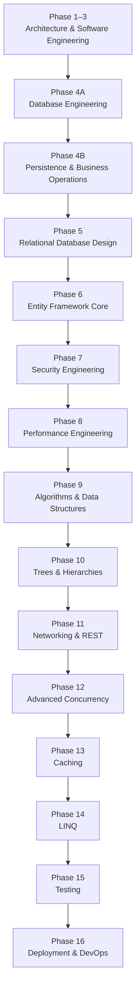

# Path.md

# CSBank Learning Path

This roadmap is designed to build **CSBank** while learning backend engineering from first principles.

Each phase introduces new concepts only after the previous foundation has been understood, ensuring every abstraction is learned through implementation rather than memorization.

The objective is not simply to build a banking system, but to understand **why each engineering concept exists** before relying on higher-level frameworks.

---

# Learning Philosophy

CSBank follows one fundamental principle:

> **Understand the abstraction before using the abstraction.**

Every technology introduced in this roadmap should explain a concept that has already been implemented manually.

Learning progresses from concepts to abstractions:

```text
Programming

↓

Object-Oriented Programming

↓

Software Engineering

↓

Database Engineering

↓

Persistence Engineering

↓

Business Operations Engineering

↓

Relational Database Design

↓

Entity Framework Core

↓

Security Engineering

↓

Performance Engineering

↓

Production Engineering
```

Frameworks should increase productivity—not replace understanding.

---

# Current Progress

| Phase                                                    | Status     |
| -------------------------------------------------------- | ---------- |
| Phase 1–3 — Clean Architecture & Software Engineering    | ✅ Complete |
| Phase 4A — PostgreSQL & Database Engineering             | ✅ Complete |
| Phase 4B — Persistence & Business Operations Engineering | ✅ Complete |
| Phase 5 — Relational Database Design                     | ✅ Complete |
| Phase 6 — Entity Framework Core                          | ✅ Complete |
| Phase 7 — Security Engineering                           | ✅ Complete |
| Phase 8 — Performance Engineering                        | 🚧 Current |

Current milestone:

The architectural and security foundations are now complete.

CSBank currently follows a hybrid persistence architecture:

* Reads → Dapper
* Selected writes / aggregate updates → Entity Framework Core
* Complex atomic banking workflows → Dapper + PostgreSQL

The project intentionally does not treat EF Core as a replacement for SQL.

Major business functionality has been completed, including:

* Customer Registration
* Customer Profile
* Customer Update
* Account Creation
* Deposit
* Transfer
* Transaction History with OFFSET pagination
* Authentication
* Authorization
* JWT Access Tokens
* Refresh Tokens
* Refresh Token Rotation
* Refresh Token Expiration
* Refresh Token Revocation
* Logout
* Security Auditing

The security foundation is now considered complete.

Current work focuses on **performance, reliability, and production engineering**.

---

# Learning Roadmap



---

# Phase 1–3 — Clean Architecture & Software Engineering ✅

## Purpose

Understand how enterprise applications separate responsibilities before introducing persistence.

## Concepts learned

* Clean Architecture
* Solution organization
* Domain Models
* Domain Services
* Business Rules
* DTOs
* Manual Mapping
* Repository Abstractions
* Dependency Injection
* Application Services
* Customer Registration

## Major outcome

Built a complete backend architecture independent of any persistence technology.

---

# Phase 4A — PostgreSQL & Database Engineering ✅

## Purpose

Understand how relational databases store, protect, and retrieve data before introducing persistence libraries.

## Database Fundamentals

* CREATE DATABASE
* Schemas
* Tables
* Data Types

## CRUD

* INSERT
* SELECT
* UPDATE
* DELETE
* RETURNING
* Writable CTEs

## Relationships

* Primary Keys
* Foreign Keys
* One-to-One
* One-to-Many

## Transactions

* BEGIN
* COMMIT
* ROLLBACK
* Statement-level atomicity
* Transaction-level atomicity

## Constraints

* UNIQUE
* CHECK
* Referential Integrity
* Cascade behaviors

## Query Design

* JOINs
* Aggregation
* GROUP BY
* COUNT
* EXISTS
* LIMIT
* OFFSET
* Explicit column selection

## ORM Mental Model

Understand:

* PostgreSQL stores relational data.
* SQL reconstructs relationships.
* Dapper executes SQL directly.
* EF Core builds abstractions over SQL.

## Major outcome

Transitioned from isolated SQL statements to complete relational workflows.

---

# Phase 4B — Persistence & Business Operations Engineering ✅

## Purpose

Understand how enterprise applications execute business operations safely, atomically, and efficiently.

## Technologies

* PostgreSQL
* Npgsql
* Dapper

## Infrastructure Concepts

* Connection Factory
* Repository Pattern
* Repository Executor
* Higher-Order Functions
* Dependency Injection
* Transaction abstraction
* SQL organization
* Connection lifecycle management
* Transaction lifecycle management

## Language Concepts

* Delegates
* Func<>
* Lambda Expressions
* Higher-Order Functions
* Async / Await

## Persistence Concepts

* Transaction management
* Repository orchestration
* Common Table Expressions (CTEs)
* Writable CTEs
* Row-level locking (`FOR UPDATE`)
* Atomic SQL workflows
* Parameterized SQL
* Race condition prevention
* Exception propagation
* Database-driven consistency

## Business Concepts

* Customer Registration
* Account Creation
* Deposit
* Transfer
* Ledger Architecture
* Transaction History
* Audit Logging
* Balance Consistency
* Business Workflow Modeling

## Completed Operations

* Customer Registration ✅
* Customer Profile ✅
* Update Customer ✅
* Create Account ✅
* Deposit ✅
* Transfer ✅
* Transaction History (OFFSET Pagination) ✅

## Major Outcome

Built reusable persistence infrastructure capable of executing complete banking workflows while validating concurrency, ledger consistency, and transactional correctness.

---

# Phase 5 — Relational Database Design ✅

## Purpose

Understand how enterprise databases evolve beyond CRUD.

## Topics Learned

* One-to-One
* One-to-Many
* Many-to-Many
* Composite Keys
* Candidate Keys
* Alternate Keys
* Normalization (1NF–3NF)
* Denormalization
* Constraint Design
* Index Strategy
* Schema Evolution
* ERD Refinement
* PostgreSQL schemas
* PostgreSQL enums

## Major Outcome

Developed the ability to model and evolve relational databases according to business requirements, justify relationships and constraints, and confidently modify schemas as the domain evolves.

---

# Phase 6 — Entity Framework Core ✅

## Purpose

Understand Entity Framework Core as an abstraction built upon concepts already mastered manually.

## Technologies

* Entity Framework Core
* PostgreSQL
* Npgsql

## Core Components

* DbContext
* DbSet
* Entity States
* Change Tracker

## Mapping

* Fluent API
* Entity Configuration
* Navigation Properties
* Relationship Mapping
* PostgreSQL Enum Mapping

## Querying

* Generated SQL Inspection
* Tracking vs AsNoTracking
* Loading Strategies
* SQL Comparison with Dapper

## Persistence

* Repository Integration
* Update Aggregate
* SaveChanges Pipeline
* Unit of Work

## Engineering

* EF Core vs Dapper
* Change Tracking
* Performance Trade-offs
* ORM abstraction boundaries

## Conceptually Understood

* Migrations
* Value Converters
* Owned Types

## Major Outcome

Successfully integrated EF Core into the project while preserving the project's persistence philosophy.

The application intentionally uses the most appropriate persistence technology for the operation:

* Dapper for explicit SQL and complex read / transactional workflows
* EF Core where change tracking and aggregate updates provide value

---

# Phase 7 — Security Engineering ✅

## Purpose

Prepare CSBank for production by protecting user identities, financial operations, authentication state, and sensitive information.

## Authentication

Completed:

* Identity
* Login
* Stateless Authentication
* Sessions vs JWT
* Authentication Middleware
* Protected Endpoints

## Password Security

Completed:

* Password Hashing
* Salt
* Work Factor
* Password Verification
* Secure Password Handling

## JWT

Completed:

* Claims
* Signature
* Expiration
* Token Validation
* Access Token Generation
* Token Validation Parameters
* Issuer
* Audience
* Role Claims
* User Identity Claims

## Refresh Tokens

Completed:

* Refresh Token Generation
* Refresh Token Hashing
* Refresh Token Persistence
* Refresh Token Rotation
* Refresh Token Expiration
* Refresh Token Validation
* Refresh Token Revocation
* Logout / Session Revocation

The database remains responsible for refresh-token state.

Expiration is evaluated against `expires_at`, while explicit revocation is represented by `revoked_at`.

## Authorization

Completed:

* Roles
* Claims
* Authorization Middleware
* Protected Resources
* Resource Ownership Validation

## API Security

Completed:

* Protected Endpoints
* Ownership Validation
* Input Validation
* SQL Injection Prevention
* Parameterized SQL
* Secure Exception Handling

## Secret Management

Implemented / understood:

* Configuration
* Environment-based secrets
* Secure connection configuration

## HTTPS

Implemented / understood:

* HTTPS
* TLS concepts
* Secure communication

## Auditing

Completed:

* Login Audit
* Sensitive Action Audit
* Actor Tracking
* Entity Tracking
* Previous Values
* New Values
* Timestamp Tracking

Audit records remain separate from business entities and are generated as part of the relevant persistence workflows.

## Cancellation and Request Lifetime

Completed:

* `CancellationToken` propagation
* HTTP request cancellation
* Repository cancellation
* Dapper `CommandDefinition`
* Database command cancellation
* Command timeouts

Long-running operations such as deposit and transfer use explicit command timeouts, while other database operations use appropriate shorter limits.

## Major Outcome

CSBank now has a complete security foundation covering authentication, authorization, token lifecycle management, auditing, secure error handling, request cancellation, and database command control.

Security Engineering is considered complete.

---

# Phase 8 — Performance Engineering 🚧

## Purpose

Understand how engineering decisions affect scalability, resource consumption, and responsiveness.

The primary principle is:

> **Measure first. Optimize second.**

Performance improvements should be justified through execution plans, benchmarks, profiling, or other measurable evidence.

## PostgreSQL

* EXPLAIN
* EXPLAIN ANALYZE
* Execution Plans
* Sequential Scan vs Index Scan
* Composite Indexes
* Covering Indexes
* Query Optimization
* EXISTS vs JOIN
* LIMIT / OFFSET
* Keyset / Cursor Pagination
* Window Functions
* Locking behavior
* Query latency
* Database command timeouts

## Dapper

* QueryMultiple
* Multi Mapping
* Buffered vs Streaming
* CommandDefinition
* CancellationToken
* Command Timeouts
* Allocation Reduction
* Connection usage
* Round-trip reduction

## EF Core

* Generated SQL
* Compiled Queries
* Split Queries
* N+1 Detection
* Change Tracker Cost
* AsNoTracking Performance
* SaveChanges behavior
* Query performance

## .NET

* Collections
* LINQ Performance
* Span<T>
* Memory Allocation
* ValueTask
* Async performance
* CancellationToken
* BenchmarkDotNet
* Profiling

## Major Objective

Optimize only after measuring.

Performance engineering should remain a continuous engineering responsibility rather than a one-time optimization phase.

---

# Phase 9 — Algorithms & Data Structures

## Topics

* Searching
* Sorting
* Hash Tables
* Queues
* Stacks
* Graph Basics
* Complexity Analysis

## Purpose

Apply algorithms where they improve backend systems and understand the computational cost of implementation decisions.

---

# Phase 10 — Trees & Hierarchies

## Topics

* Recursive Traversal
* Trees
* Parent-child Relationships
* Recursive SQL

## Purpose

Model hierarchical business data.

---

# Phase 11 — Networking & REST

## Topics

* HTTP
* HTTPS
* REST
* Status Codes
* API Design
* CORS
* Idempotency
* API Versioning
* Request / Response Semantics

## Purpose

Understand communication between distributed systems rather than treating HTTP as merely a framework feature.

---

# Phase 12 — Advanced Concurrency

## Topics

* Isolation Levels
* Optimistic Concurrency
* Pessimistic Locking
* Deadlocks
* Retry Strategies
* Concurrent Updates
* Transaction Conflicts
* Distributed Concurrency

## Purpose

Design systems that remain correct under concurrent workloads.

---

# Phase 13 — Caching

## Topics

* IMemoryCache
* Redis
* Distributed Cache
* Cache Aside
* Cache Invalidation
* Consistency Considerations

## Purpose

Improve performance while maintaining correctness and consistency.

---

# Phase 14 — LINQ

## Purpose

Master LINQ as a language feature before relying on it throughout enterprise applications.

## Topics

* IEnumerable
* IQueryable
* Deferred Execution
* Projection
* Filtering
* Ordering
* Grouping
* Aggregation
* Set Operations
* Execution Characteristics
* Performance Implications

## Major Outcome

Understand LINQ rather than memorizing extension methods.

---

# Phase 15 — Testing

## Purpose

Verify business correctness and prevent regressions.

## Technologies

* xUnit
* NSubstitute

## Topics

* Unit Testing
* Integration Testing
* API Testing
* Repository Testing
* Database Testing
* Concurrency Testing
* Authentication Testing
* Authorization Testing
* Security Testing
* Performance Testing

---

# Phase 16 — Deployment & DevOps

## Topics

* Docker
* Docker Compose
* CI/CD
* Environment Configuration
* Cloud Deployment
* Logging
* Monitoring
* Health Checks
* Configuration Management
* Production Diagnostics

## Purpose

Operate backend systems reliably in production.

---

# Architecture Principles Maintained Throughout All Phases

The project continues to follow these architectural boundaries:

```text
HTTP Request

↓

API / Controller

↓

Application Service

↓

Domain

↓

Repository Interface

↓

Infrastructure Repository

       ├── Dapper
       │
       └── Entity Framework Core

↓

PostgreSQL
```

Layer responsibilities:

* **Domain** owns business rules.
* **Application** owns orchestration and use cases.
* **Infrastructure** owns persistence implementation.
* **PostgreSQL** owns relational consistency.
* **API** owns HTTP concerns and composition.

The Domain remains persistence-agnostic.

---

# Persistence Philosophy

CSBank does not follow the principle that one persistence technology must be used everywhere.

Instead:

```text
Choose the abstraction based on the problem.
```

Dapper is preferred when:

* SQL control is important.
* Complex SQL workflows are required.
* Writable CTEs are useful.
* Precise database behavior matters.
* Database round trips should be explicitly controlled.

EF Core is preferred when:

* Change tracking provides value.
* Aggregate updates benefit from Unit of Work.
* Entity state management reduces unnecessary persistence code.

The objective is not to minimize framework usage.

The objective is to understand the underlying behavior well enough to choose the correct abstraction.

---

# SQL Philosophy

Whenever appropriate:

```text
One Transaction

↓

One SQL Statement

↓

Multiple Writable CTEs

↓

One Database Round Trip
```

The database should be treated as an execution engine—not merely a storage engine.

Business operations should preserve:

* Atomicity
* Consistency
* Concurrency correctness
* Ledger integrity
* Audit integrity

---

# Ledger Philosophy

Account balances are mutable.

Transaction history is immutable.

Balances represent the current projection.

The ledger represents historical truth.

Financial operations must preserve the relationship between current account state and historical transaction records.

---

# Audit Philosophy

Audit logging remains independent from business entities.

Audit records capture:

* Entity
* Action
* Actor
* Timestamp
* Previous values (optional)
* New values (optional)

Security-sensitive operations such as authentication and token rotation generate appropriate audit records.

---

# End Goal

Build a production-quality banking backend while understanding every abstraction throughout the backend stack.

By completing CSBank, the project should demonstrate practical engineering knowledge in:

* Clean Architecture
* Software Engineering
* PostgreSQL
* Database Engineering
* Dapper
* Entity Framework Core
* Hybrid Persistence Architecture
* Security Engineering
* Performance Engineering
* Algorithms & Data Structures
* Networking
* Advanced Concurrency
* Caching
* LINQ
* Testing
* Deployment

Every phase intentionally builds upon the previous one so that each abstraction reinforces concepts already understood instead of replacing them.

The objective is not simply to complete CSBank.

The objective is to develop the engineering mindset required to **design, build, debug, measure, secure, and maintain production-quality backend systems from first principles.**
